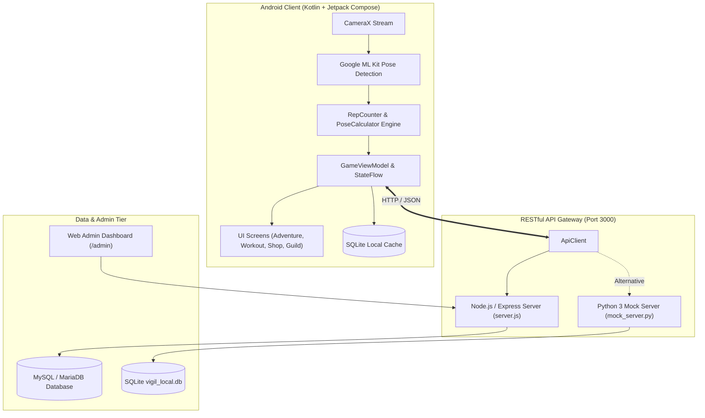

<p align="center">
  
</p>

<h1 align="center">Vigil — RPG Fitness App</h1>

<p align="center">
  <strong>Ứng dụng di động biến hành trình rèn luyện thể thao thành trải nghiệm game nhập vai đánh quái theo thời gian thực.</strong>
</p>

<p align="center">
  
  
  
  
  
</p>

<p align="center">
  <a href="#tổng-quan">Tổng quan</a> •
  <a href="#tính-năng-nổi-bật">Tính năng nổi bật</a> •
  <a href="#kiến-trúc-hệ-thống">Kiến trúc</a> •
  <a href="#hướng-dẫn-chạy-dự-án">Chạy trên máy</a> •
  <a href="#cấu-trúc-thư-mục">Cấu trúc repo</a> •
  <a href="#api-chính">API Endpoints</a> •
  <a href="#đóng-góp">Đóng góp</a>
</p>

---

## Tổng quan

Việc tự rèn luyện thể thao tại nhà (Calisthenics, Bodyweight workout) thường gặp hai rào cản lớn: thiếu phản hồi về độ chuẩn xác của động tác và thiếu động lực duy trì đều đặn.

**Vigil** kết hợp công nghệ **Thị giác máy tính (Computer Vision)** chạy trực tiếp trên thiết bị (On-Device) với cơ chế **Trò chơi hóa (Gamification)**:
* Camera AI theo dõi và đếm rep theo từng góc độ khớp xương chuẩn, đảm bảo bảo mật riêng tư tuyệt đối (không gửi luồng hình ảnh lên máy chủ).
* Mỗi lần lặp (rep) hợp lệ được chuyển đổi thành sát thương tấn công quái vật, hoàn thành nhiệm vụ, thu thập trang bị và cùng bang hội săn Boss thế giới.

---

## Tính năng nổi bật

### 🎯 1. Nhận diện chuyển động thời gian thực (On-Device AI)
* **Khung xương 33 điểm mốc**: Sử dụng Google ML Kit Pose Detection kết hợp CameraX, xử lý mượt mà ở tốc độ 20–30 FPS.
* **Hỗ trợ 6 bài tập**:
  * **Hít đất (Push-up)** & **Dip**: Tính toán góc gập khuỷu tay ($95^\circ \rightarrow 155^\circ$).
  * **Squat**: Đo góc mở khớp gối ($105^\circ \rightarrow 160^\circ$).
  * **Gập bụng (Sit-up)**: Theo dõi góc gập thân người ($80^\circ \rightarrow 115^\circ$).
  * **Plank**: Tự động nhận diện tư thế thẳng trục và kích hoạt đồng hồ đếm giây giữ (`1 điểm / 2 giây`).
  * **Hít xà (Pull-up)**: Đo biên độ kéo ngực ($75^\circ \rightarrow 150^\circ$).
* **Lọc nhiễu & Khử rep ảo**: Thuật toán `PoseCalculator` và `RepCounter` áp dụng bộ đệm trượt (*Rolling Average*) cùng máy trạng thái hữu hạn (*Finite State Machine*) để đảm bảo động tác phải đủ biên độ mới tính điểm.

### ⚔️ 2. Hệ thống nhập vai RPG & Phiêu lưu (Adventure Mode)
* **4 Chương hành trình với 12 Quái vật & Boss độc đáo**:
  * *Chương 1: Đồng Cỏ Ngập Nắng* — Slime Gai, Sói Xám, Yêu Tinh Cung Thủ, Trùm Hộ Vệ Đồng Cỏ.
  * *Chương 2: Rừng Già Hắc Ám* — Nhện Độc, Quỷ Lùn, Trùm Ma Cây Cổ Thụ.
  * *Chương 3: Hẻm Núi Nham Thạch* — Hỏa Lang, Golem Dung Nham, Chúa Tể Hỏa Ngục Hắc Long.
  * *Chương 4: Tháp Băng Vực Thẳm* — Hồn Ma Băng Giá, Bá Chủ Chúa Tể Băng Cổ Đại.
* **Hệ thống 48 trang bị RPG & 8 phẩm cấp**:
  * Đầy đủ 6 slot: Mũ, Giáp, Găng, Giày, Bùa, Vũ khí.
  * Phẩm cấp từ Phổ thông đến Thần thoại, cộng các chỉ số: Sức mạnh (STR), Thể lực (END), Chuẩn xác (PRE), Vận may (LUCK).
  * **Thuật toán rơi đồ ngẫu nhiên**: Tỷ lệ nhặt trang bị hiếm sau trận đấu tỷ lệ thuận với chỉ số Vận may (LUCK) của người chơi.

### 👥 3. Bang hội & Săn Boss thế giới (Guild Boss Raid)
* Thành lập bang hội, duyệt đơn thành viên và theo dõi điểm cống hiến tập luyện.
* Săn Boss thế giới: Tất cả thành viên trong bang cùng tham gia tích lũy sát thương từ các buổi tập vào thanh máu tổng của Boss để nhận phần thưởng lớn.

### 🖥️ 4. Bảng điều khiển Quản trị (Web Admin Dashboard)
* Giao diện trực quan dành cho quản trị viên tại `/admin`.
* Quản lý danh sách người dùng, phát hiện gian lận và khóa tài khoản vi phạm.
* Cấu hình nóng (*Hot-reconfig*): Chỉnh sửa lượng máu quái vật, tỷ lệ rớt đồ và ngưỡng góc khớp bài tập trực tiếp từ giao diện web mà không cần biên dịch lại app di động.

---

## Kiến trúc hệ thống



---

## Hướng dẫn chạy dự án

### Yêu cầu môi trường
* **Android Studio**: Ladybug / Hedgehog hoặc mới hơn.
* **Android SDK**: Compile SDK 37 (hoặc 34), Min SDK 26 (Android 8.0+).
* **JDK**: OpenJDK 17 trở lên.
* **Backend**: Node.js 18+ & MySQL (hoặc chỉ cần Python 3.10+ nếu dùng Mock Server).

---

### Bước 1: Khởi động Backend Server

Bạn có thể chọn một trong hai cách dưới đây:

#### Cách A: Chạy với Node.js & MySQL (Khuyên dùng)
1. Mở MySQL (qua XAMPP, Docker hoặc MySQL Server cục bộ) và tạo database:
   ```sql
   CREATE DATABASE vigil_db CHARACTER SET utf8mb4 COLLATE utf8mb4_unicode_ci;
   ```
2. Cài đặt phụ thuộc và khởi động server:
   ```bash
   cd server
   npm install
   npm start
   ```
3. Server sẽ tự động chạy tại `http://localhost:3000`. Nếu MySQL chưa bật, server có cơ chế **In-memory fallback** để không làm gián đoạn thử nghiệm.

#### Cách B: Chạy nhanh bằng Python Mock Server (Không cần cài MySQL/Node.js)
```bash
cd server
python mock_server.py
```
*Server sẽ tự tạo file CSDL SQLite `vigil_local.db`, nạp sẵn toàn bộ dữ liệu mẫu và lắng nghe tại `http://localhost:3000`.*

Kiểm tra trạng thái server: Truy cập `http://localhost:3000/api/health`, nếu trả về `{"status": "ok"}` là backend đã sẵn sàng.

---

### Bước 2: Truy cập Web Admin Dashboard

Sau khi server đã chạy, mở trình duyệt và truy cập:
```text
http://localhost:3000/admin
```
Tại đây bạn có thể xem tổng quan số người dùng, danh sách bài tập, quản lý kho vật phẩm và cấu hình quái vật.

---

### Bước 3: Chạy ứng dụng Android

1. Mở Android Studio, chọn **Open** và trỏ đến thư mục `Project1_MNM`.
2. Chờ Android Studio đồng bộ xong Gradle dependencies.
3. Cấu hình kết nối:
   * **Nếu chạy trên Android Emulator**: Ứng dụng đã mặc định trỏ về `http://10.0.2.2:3000` (địa chỉ localhost của máy chủ nhìn từ máy ảo Android).
   * **Nếu chạy trên điện thoại thật**: Đảm bảo điện thoại và máy tính cùng chung mạng Wi-Fi, sửa `baseUrl` trong file `app/src/main/java/com/example/vigil/network/ApiClient.kt` thành IP nội bộ máy tính của bạn (ví dụ: `http://192.168.1.x:3000`).
4. **Cấu hình Camera trên máy ảo**: Vào *AVD Manager* -> Chọn máy ảo -> *Edit* -> *Advanced Settings* -> Tại mục *Camera*, đổi cả *Front* và *Back* sang `Webcam0` để camera máy ảo nhận webcam laptop của bạn.
5. Bấm nút **Run** (phím tắt `Shift + F10`) để cài đặt và trải nghiệm ứng dụng.

---

## Cấu trúc thư mục

```text
Project1_MNM/
├── app/                                 # Module ứng dụng Android Native
│   ├── src/main/
│   │   ├── AndroidManifest.xml          # Khai báo quyền Camera, Internet
│   │   ├── java/com/example/vigil/
│   │   │   ├── MainActivity.kt          # Single-Activity & Navigation Host
│   │   │   ├── data/
│   │   │   │   ├── GameViewModel.kt     # Quản lý State & logic nghiệp vụ
│   │   │   │   └── VigilSqlDb.kt        # SQLiteOpenHelper lưu trữ offline
│   │   │   ├── model/                   # Data models (Monster, Item, Guild,...)
│   │   │   ├── network/
│   │   │   │   └── ApiClient.kt         # OkHttp client giao tiếp REST API
│   │   │   ├── pose/
│   │   │   │   ├── PoseCalculator.java  # Tính toán góc độ khớp xương
│   │   │   │   └── RepCounter.kt        # Máy trạng thái đếm số lần lặp
│   │   │   └── ui/                      # Toàn bộ giao diện Jetpack Compose
│   │   │       ├── Screens.kt           # Today, Adventure, Hero, Guild,...
│   │   │       ├── ShopScreen.kt        # Giao diện tiệm rèn & mua bán
│   │   │       ├── WorkoutScreen.kt     # Camera tracking & sàn đấu AI
│   │   │       └── AuthScreen.kt        # Đăng ký / Đăng nhập
│   │   └── res/                         # Tài nguyên ảnh, icon, string
│   └── build.gradle.kts                 # Cấu hình dependency CameraX, ML Kit
│
├── server/                              # Module máy chủ Backend & Admin
│   ├── server.js                        # Node.js Express REST API server chính
│   ├── mock_server.py                   # Python lightweight server dự phòng
│   ├── database.sql                     # Kịch bản khởi tạo bảng & dữ liệu mẫu MySQL
│   ├── package.json                     # Node.js dependencies
│   ├── README.md                        # Tài liệu hướng dẫn riêng cho backend
│   └── admin/                           # Web Admin Dashboard
│       ├── index.html                   # Giao diện trung tâm quản trị
│       ├── css/admin.css                # Định kiểu dashboard
│       └── js/admin.js                  # Logic gọi API cấu hình & quản lý
│
├── .github/                             # Mẫu đóng góp mã nguồn mở
│   ├── ISSUE_TEMPLATE/                  # Mẫu báo lỗi & đề xuất tính năng
│   └── pull_request_template.md         # Mẫu kiểm tra Pull Request
├── .gitignore                           # Danh sách loại trừ file nhị phân/cache
├── build.gradle.kts                     # Cấu hình Gradle gốc
└── README.md                            # Tài liệu chính của dự án
```

---

## API Endpoints tiêu biểu

| Phương thức | Đường dẫn API | Mô tả nghiệp vụ |
| :--- | :--- | :--- |
| `GET` | `/api/health` | Kiểm tra tình trạng hoạt động của máy chủ |
| `POST` | `/api/auth/register` | Đăng ký tài khoản người chơi mới |
| `POST` | `/api/auth/login` | Đăng nhập tài khoản |
| `GET` | `/api/user/:username` | Lấy thông tin chỉ số nhân vật và kho đồ |
| `GET` | `/api/shop/items` | Lấy danh mục 48 vật phẩm trong cửa hàng |
| `POST` | `/api/shop/buy` | Mua trang bị bằng Vàng hoặc Kim Cương |
| `POST` | `/api/inventory/equip` | Trang bị vật phẩm vào ô đồ tương ứng |
| `POST` | `/api/workout/finish` | Kết thúc bài tập, cập nhật rep, tính toán rớt đồ LUCK |
| `GET` | `/api/guild/boss` | Lấy trạng thái máu và bảng cống hiến Boss thế giới |
| `POST` | `/api/guild/boss/attack`| Góp sát thương từ buổi tập vào Boss thế giới |
| `GET` | `/api/admin/overview` | Thống kê số liệu người dùng & hệ thống cho Admin |
| `POST` | `/api/admin/users/lock` | Khóa hoặc mở khóa tài khoản người dùng |

---

## Đóng góp & Phát triển

Chúng tôi hoan nghênh mọi đóng góp từ cộng đồng nhằm nâng cao trải nghiệm ứng dụng:

1. **Fork** repository về tài khoản cá nhân.
2. Tạo nhánh tính năng mới:
   ```bash
   git checkout -b feature/ten-tinh-nang-moi
   ```
3. Commit các thay đổi với thông điệp rõ ràng theo chuẩn [Conventional Commits](https://www.conventionalcommits.org/):
   ```bash
   git commit -m "feat: bo sung bai tap jumping jack"
   ```
4. Đẩy nhánh lên GitHub:
   ```bash
   git push origin feature/ten-tinh-nang-moi
   ```
5. Mở **Pull Request** trên repository gốc và điền đầy đủ thông tin theo mẫu.

---

## Giấy phép (License)

Dự án được phát hành theo giấy phép nguồn mở **MIT License**. Bạn có thể tự do nghiên cứu, tùy biến và phát triển tiếp vì mục đích học tập và cộng đồng.

---

<p align="center">
  <em>Được phát triển bởi Nhóm 3 — Học phần Project 1 & Phát triển Phần mềm Mã nguồn mở<br>Trường Đại học Giao thông Vận tải (UTC)</em>
</p>
